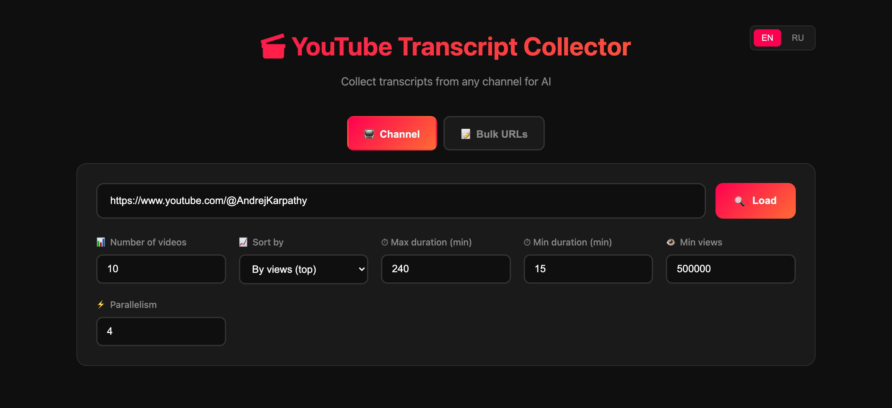
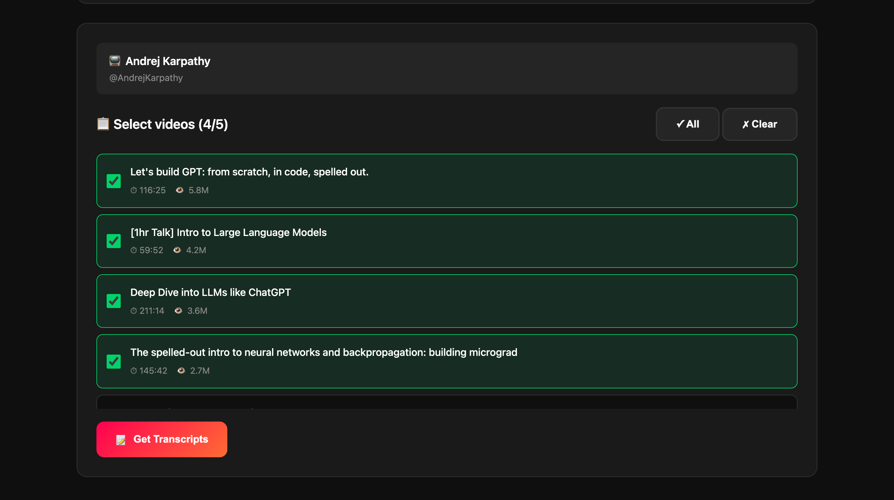
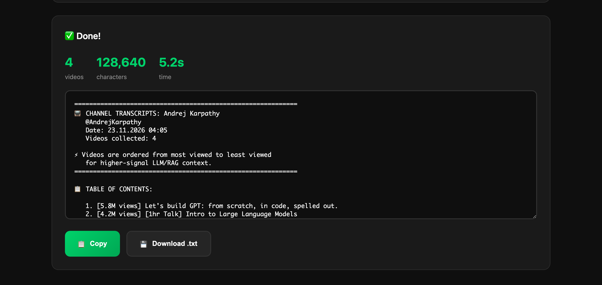

# 🎬 YouTube Transcript Collector

<div align="center">

[](https://www.python.org/)
[](https://flask.palletsprojects.com/)
[](https://github.com/yt-dlp/yt-dlp)
[](LICENSE)
[](#installation)

**Bulk YouTube channel & video transcript collector built for LLM and RAG pipelines — Flask Web UI + CLI with duration/view filters, sorting, and parallel downloads.**

🇺🇸 **English** | [🇷🇺 Русская версия](README.ru.md)

[Quick Start](#-quick-start) • [Screenshots](#-screenshots) • [CLI Usage](#-command-line-cli) • [Installation](#-installation) • [Related Tool](#-need-offline-asr-for-videos-without-captions)

<br>



</div>

---

## ✨ Key Features

- **Dark-Mode Web UI (EN/RU)** — Paste a channel or video URL, filter videos visually, and export clean transcripts in one click.
- **Channel & Bulk URLs Modes** — Scrape top videos from any `@handle` / channel, or paste raw text with mixed YouTube URLs to extract & process them in batch.
- **Smart Filters & Sorting** — Filter by min/max duration, minimum view count, and top-N limit; sort by views (most popular) or upload date (newest).
- **Parallel Downloads** — Multi-threaded `yt-dlp` execution (1–10 workers) with randomized jitter and automatic 429 rate-limit retry.
- **LLM / RAG-Ready Output** — Combines transcripts into a single structured `.txt` with a table of contents ordered by popularity, ready to paste into ChatGPT, Claude, or NotebookLM.
- **Chrome Cookies & Smart Language Detection** — Reuses browser cookies to reduce YouTube bot checks and auto-selects original video caption tracks (`en` / `ru` / detected language).
- **CLI for Automation** — Standalone `yt_transcripts.py` script with clipboard copy (`--copy`) and file output (`-o`).

---

## 📸 Screenshots

<table>
  <tr>
    <td><strong>1. Filter & Select Channel Videos</strong></td>
    <td><strong>2. Export LLM-Ready Transcripts</strong></td>
  </tr>
  <tr>
    <td></td>
    <td></td>
  </tr>
</table>

---

## 🚀 Quick Start

```bash
git clone https://github.com/Lemelson/youtube-transcript-collector.git
cd youtube-transcript-collector

python3 -m venv venv
source venv/bin/activate        # Windows: venv\Scripts\activate
pip install -r requirements.txt

python3 app.py                  # or ./start.sh on macOS/Linux
```

Open **`http://localhost:5847`** in your browser and press `Ctrl+C` in the terminal to stop.

> **Important: keep `yt-dlp` updated.** YouTube regularly changes its JS challenges — run `pip install -U yt-dlp` if downloads fail.

---

## 📖 Usage

### Web Interface

1. Choose **Channel** mode (paste `youtube.com/@channel` or a single video URL) or **Bulk URLs** mode (paste any list or text containing YouTube links).
2. Configure filters: number of videos (`1–50`), sort order (`views` / `newest`), min/max duration (minutes), min views, and parallel workers (`1–10`).
3. Click **Load**, review and check/uncheck videos in the list.
4. Click **Get Transcripts** — monitor live progress and debug logs.
5. **Copy** to clipboard or **Download `.txt`** directly for your LLM / RAG workflow.

### Command Line (CLI)

```bash
source venv/bin/activate

# Single video — copy directly to clipboard (macOS)
python3 yt_transcripts.py "https://www.youtube.com/watch?v=VIDEO_ID" --copy

# Top 10 most-viewed videos from a channel
python3 yt_transcripts.py "https://www.youtube.com/@AndrejKarpathy" --top 10

# Channel with filters, sorting, and custom output file
python3 yt_transcripts.py "https://www.youtube.com/@AndrejKarpathy" \
  --top 20 \
  --max-duration 60 \
  --min-duration 10 \
  --min-views 50000 \
  --sort views \
  --workers 4 \
  -o channel_transcripts.txt
```

#### CLI Options

| Flag | Default | Description |
|---|---|---|
| `url` | *(required)* | YouTube channel or single video URL |
| `--top N` | `10` | Maximum number of videos to process |
| `--max-duration N` | — | Maximum video duration in minutes |
| `--min-duration N` | — | Minimum video duration in minutes |
| `--min-views N` | — | Minimum view count filter |
| `--sort {views,duration}` | `views` | Sort order for channel videos |
| `--workers N` | `4` | Parallel worker threads (`1–10`) |
| `-o, --output FILE` | auto | Output `.txt` file path |
| `--copy` | off | Copy combined transcript to clipboard (`pbcopy` on macOS) |

---

## 🛠 Installation

### Requirements

- **Python 3.9+**
- **[`yt-dlp`](https://github.com/yt-dlp/yt-dlp)** (latest version, `>= 2026.2.4`)
- **Google Chrome** (used by `--cookies-from-browser chrome` to avoid YouTube blocks)

```bash
git clone https://github.com/Lemelson/youtube-transcript-collector.git
cd youtube-transcript-collector

python3 -m venv venv
source venv/bin/activate
pip install -r requirements.txt
pip install -U yt-dlp
```

---

## 🔄 Need Offline ASR for Videos Without Captions?

This repository focuses on **fast caption collection, channel discovery, and visual filtering**. If you need to transcribe videos that **have no YouTube captions** or want **top comments + structured JSON**, check out its companion project:

| Tool | Best For | Interface | No-Caption Fallback | Extras |
|---|---|---|---|---|
| **youtube-transcript-collector** *(this repo)* | Bulk channel scraping, view/duration filtering, rapid LLM/RAG prep | **Flask Web UI** + CLI | Captions only (`yt-dlp`) | Bulk URL extractor, EN/RU UI, 1-click Copy / `.txt` |
| [**Youtube-Auto-Transcripts**](https://github.com/Lemelson/Youtube-Auto-Transcripts) | Local-first archiving & videos without subtitles | **CLI** | **Offline Parakeet MLX ASR** (Apple Silicon) | Top comments via YouTube API, `.txt` + `.json` + `.log` |

---

## 📁 Project Structure

```text
youtube-transcript-collector/
├── app.py                  # Flask web server & parallel transcript API
├── yt_transcripts.py       # Standalone CLI tool
├── templates/
│   └── index.html          # Bilingual (EN/RU) dark-mode web UI
├── docs/screenshots/       # Web UI screenshots
├── start.sh                # Quick launch script (macOS/Linux)
├── requirements.txt        # Python dependencies
├── README.md               # English documentation
├── README.ru.md            # Russian documentation
└── LICENSE                 # MIT License
```

---

## 🔧 Troubleshooting

- **JS challenge / signature errors (`EJS`)**: Update `yt-dlp` inside your virtual environment:
  ```bash
  source venv/bin/activate && pip install -U yt-dlp
  ```
- **YouTube CAPTCHA / bot check**: Open YouTube in Chrome, complete verification once, and retry.
- **Chrome cookie errors**: Close Chrome completely (or ensure Chrome is installed and signed in) and try again.
- **Rate limit (`429`)**: Lower **Parallelism** (`--workers 2`) or wait a few minutes before retrying.
- **No subtitles found**: The creator disabled captions — use [**Youtube-Auto-Transcripts**](https://github.com/Lemelson/Youtube-Auto-Transcripts) for offline speech-to-text transcription.

---

## 📄 License

[MIT License](LICENSE) — free to use, modify, and distribute.
