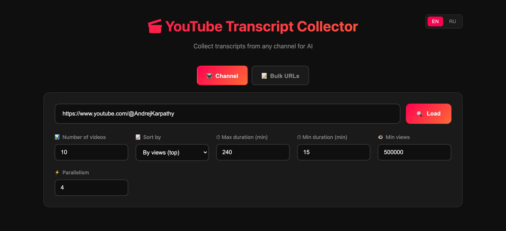
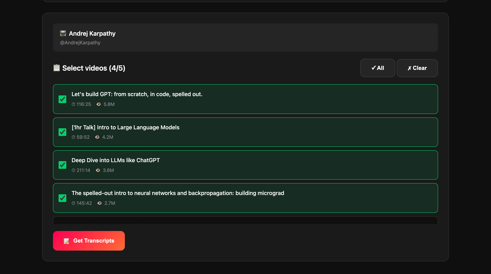
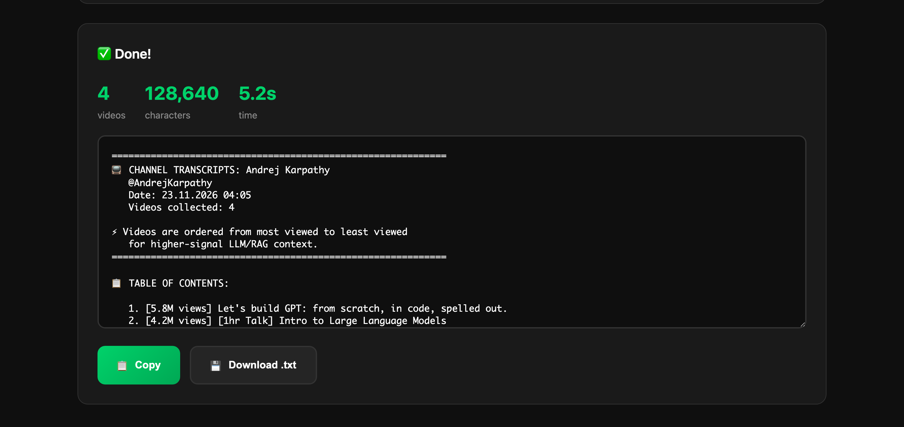

# 🎬 YouTube Transcript Collector

<div align="center">

[](https://www.python.org/)
[](https://flask.palletsprojects.com/)
[](https://github.com/yt-dlp/yt-dlp)
[](LICENSE)

**Сбор транскриптов с YouTube-каналов и списков видео для LLM и RAG — веб-интерфейс на Flask + CLI с фильтрами по длительности и просмотрам.**

[🇺🇸 English](README.md) | 🇷🇺 **Русская версия**

<br>



</div>

---

## ✨ Возможности

- **Веб-интерфейс (EN/RU)** — тёмная тема, выбор видео галочками, живой прогресс и debug-лог.
- **Два режима работы** — загрузка с канала (`@handle` / URL видео) или **Bulk URLs** (вставляете любой текст со ссылками YouTube — все ID извлекаются автоматически).
- **Гибкие фильтры и сортировка** — количество видео (`1–50`), минимальная/максимальная длительность, порог просмотров, сортировка по популярности или дате.
- **Параллельная загрузка** — до 10 потоков (`yt-dlp`), случайная задержка против rate-limit и автоматический повтор при `429`.
- **Готовый формат для AI / RAG** — единый `.txt` с оглавлением по популярности роликов, копирование в буфер обмена или скачивание в один клик.
- **Поддержка cookies Chrome и автоопределение языка** — обход проверок YouTube и выбор оригинальных субтитров ролика.
- **CLI-версия** — `yt_transcripts.py` для автоматизации и работы из терминала.

---

## 📸 Скриншоты

<table>
  <tr>
    <td><strong>1. Выбор роликов с канала</strong></td>
    <td><strong>2. Готовый экспорт транскриптов</strong></td>
  </tr>
  <tr>
    <td></td>
    <td></td>
  </tr>
</table>

---

## 🚀 Быстрый старт

```bash
git clone https://github.com/Lemelson/youtube-transcript-collector.git
cd youtube-transcript-collector

python3 -m venv venv
source venv/bin/activate        # Windows: venv\Scripts\activate
pip install -r requirements.txt

python3 app.py                  # или ./start.sh на macOS/Linux
```

Откройте в браузере **`http://localhost:5847`**. Для остановки нажмите `Ctrl+C`.

> **Важно: регулярно обновляйте `yt-dlp`!** YouTube часто меняет JS-защиту — при ошибках выполните `pip install -U yt-dlp`.

---

## 📖 Использование

### Веб-интерфейс

1. Выберите режим **Канал** или **Несколько URL** (переключатель языка `EN / RU` в правом верхнем углу).
2. Вставьте ссылку на канал (`youtube.com/@channel`) или список ссылок.
3. Настройте фильтры (количество видео, сортировка, мин/макс длительность, мин. просмотры, потоки).
4. Нажмите **Загрузить**, выберите нужные видео и нажмите **Получить транскрипты**.
5. Скопируйте результат в буфер обмена или скачайте `.txt`.

### Командная строка (CLI)

```bash
source venv/bin/activate

# Один ролик с копированием в буфер (macOS):
python3 yt_transcripts.py "https://www.youtube.com/watch?v=VIDEO_ID" --copy

# Топ-10 видео с канала:
python3 yt_transcripts.py "https://www.youtube.com/@AndrejKarpathy" --top 10

# С фильтрами и сохранением в файл:
python3 yt_transcripts.py "https://www.youtube.com/@AndrejKarpathy" \
  --top 20 --max-duration 60 --min-views 50000 --workers 4 -o result.txt
```

---

## 🔄 Нужна офлайн-расшифровка видео без субтитров?

Если у видео **нет субтитров на YouTube** или нужны **топ-комментарии + JSON**, используйте парный проект:

| Инструмент | Для чего лучше | Интерфейс | Если нет субтитров | Дополнительно |
|---|---|---|---|---|
| **youtube-transcript-collector** *(этот репо)* | Массовый сбор с каналов, фильтры по просмотрам/длительности | **Flask Web UI** + CLI | Только субтитры (`yt-dlp`) | Bulk URLs, интерфейс EN/RU, `.txt` / буфер |
| [**Youtube-Auto-Transcripts**](https://github.com/Lemelson/Youtube-Auto-Transcripts) | Локальное архивирование и видео без субтитров | **CLI** | **Офлайн ASR через Parakeet MLX** (Apple Silicon) | Топ-комментарии (YouTube API), `.txt` + `.json` + `.log` |

---

## 🔧 Решение проблем

1. **Ошибка JS challenge (`EJS`)** — обновите `yt-dlp`: `source venv/bin/activate && pip install -U yt-dlp`.
2. **YouTube требует CAPTCHA** — откройте YouTube в Chrome и пройдите проверку.
3. **Проблема с cookies** — полностью закройте Chrome и повторите попытку.
4. **Rate limit (`429`)** — снизьте число потоков до `2` или подождите 5–10 минут.
5. **Субтитры отключены автором** — воспользуйтесь [**Youtube-Auto-Transcripts**](https://github.com/Lemelson/Youtube-Auto-Transcripts) с локальным распознаванием речи.

---

## 📄 Лицензия

[MIT License](LICENSE) — свободное использование, изменение и распространение.
